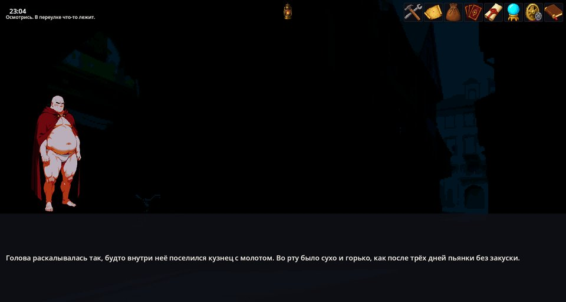
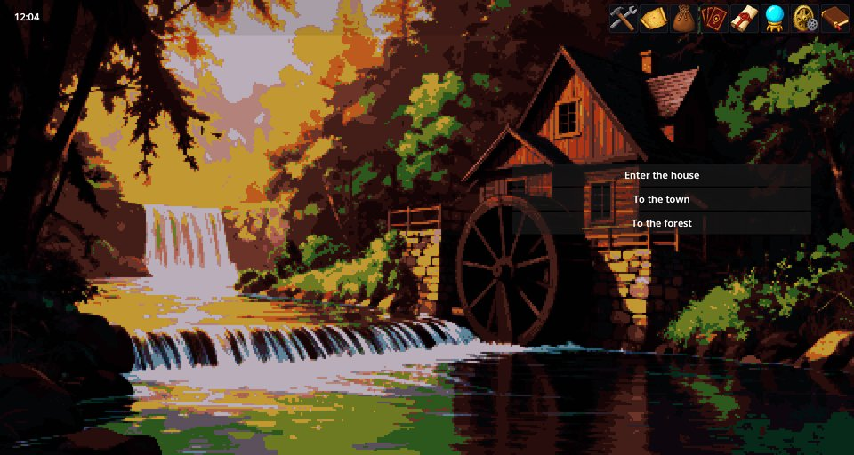
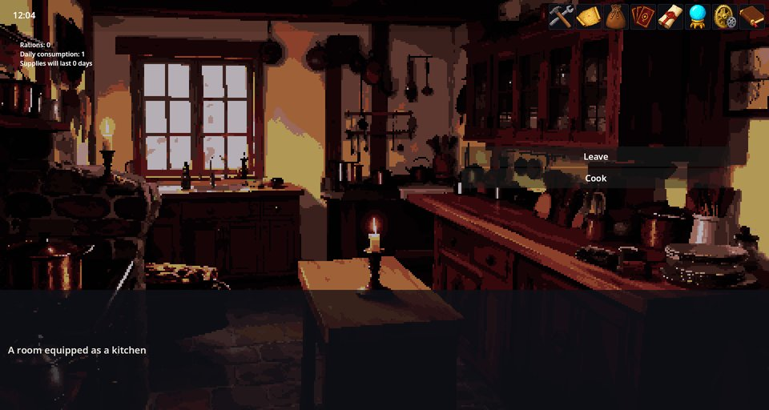
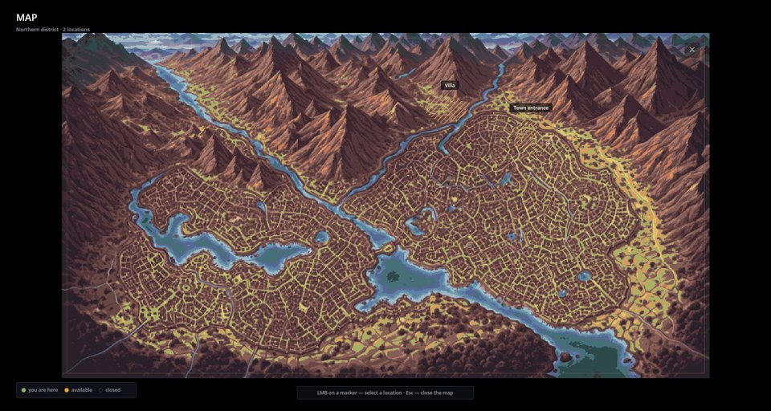
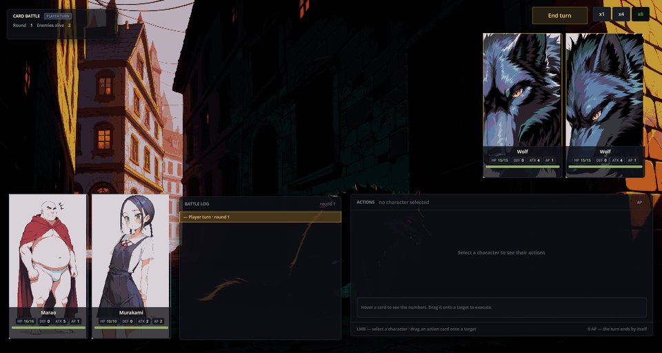

# Cthangover: Story — the main game

Cthangover is a darkly comic visual novel about Marao, a man who wakes up in an alley after a very bad night with no memory, a red rag and an old book he does not remember buying. This mod is the game's own content: its scenes, scenarios, characters, items, quests, world map, music choices and story text. Everything else — dialogues, inventory, battles, the map screen — comes from engine and mechanic mods that the game combines.

Play it from **Play → Cthangover → New game**.



## What you play

- **The prologue.** The story begins in the alley and continues through a graveyard and along the river to an old villa. The prologue is played as a novel: lines of text, Marao's portrait and choices.
- **The villa and the town.** After the prologue you move between places by choices: the outside of the villa, its rooms (vestibule, living room, kitchen, bedroom, workroom, basement), the town entrance and the outskirts.
- **Survival details.** A new game starts with wolf meat and brushwood in the bag; the kitchen tracks rations and their daily consumption and lets you cook.
- **Quests.** The journal follows the story's tasks, starting with *Awakening* and *The Old House*.
- **The world map.** The map panel shows the district with the places you can travel to.
- **Battles.** Fights use the card battle by default; the game can be switched to the command-style battle in its settings.









## Language

The prologue's scenarios are written in Russian and do not have translations yet, so its text appears in Russian in every interface language. The villa and town scenes, the quest journal, items and menus are translated.

## How the game is assembled

The game is the collection **Cthangover**. Its blocks show which mods do what:

```text
Story          cthangover_game, cthangover_murakami, cthangover_party, town_pack
2D engine      the shell, dialogues, interactives, time and light, effects, world map
Characters     characters and skills
Quests         the journal
Items          inventory, cooking
Battle         turn-based platform + card battle (default core)
Battle (FF)    command-style battle core (optional)
Recruiting     recruiting defeated characters (optional)
Live2D         animated avatars (optional)
Interface      UI toolkit, menu, audio
Developer tools (optional)  editors, validator, atlases, mod manager
```

- **Cthangover: Murakami** adds a separate story line and **Cthangover: Starter Party** puts Marao into the party at the start. They are part of the same game but separate mods.
- **Town Pack** supplies the town entrance and vestibule pictures; **Music Pack** the soundtrack. This mod adds a scene-specific playlist for the town entrance.
- The collection sets `battle.core` to `card_battle`. You can change it, or the mods of any block, in **Mods & Collections → Collections → Cthangover → Edit scheme**; your saves stay.

## For authors

The content lives in ordinary folders:

```filestree
cthangover_game/
├── scenes/          one JSON per place: name, background, ambience, default scenario
├── scenarios/       prolog/, home/, town/ and start.scenario
├── characters/      player, enemies, skills
├── items/           food, recipes, resources
├── quests/          quests.json
├── interactives/    clickable objects of the prologue scenes
├── map/map.json     world map zones and markers
├── backgrounds/, avatars/, sounds/, effects/, shaders/
└── locale/          names, quests and scenario translations in seven languages
```

A new game starts in `start_scene`, whose scenario gives the starter items and switches to the alley:

```scenario
scene: start_scene
priority: 0
is_one_run: true
---
action item.add id=food/wolf_meat count=10
action item.add id=resource/branches count=10
switch_scene prolog_alley
end
```

To change a scene's text without editing this mod, add a scenario for the same scene in your own mod, or replace a file by shipping the same name with a dependency on `cthangover_game`.

## If something goes wrong

1. **The game card says it is not ready.** Use **Install missing** in **Play**, or check the scheme.
2. **No battle starts.** The selected battle core must be included in the game.
3. **Story text in Russian.** That is the prologue (see Language).
